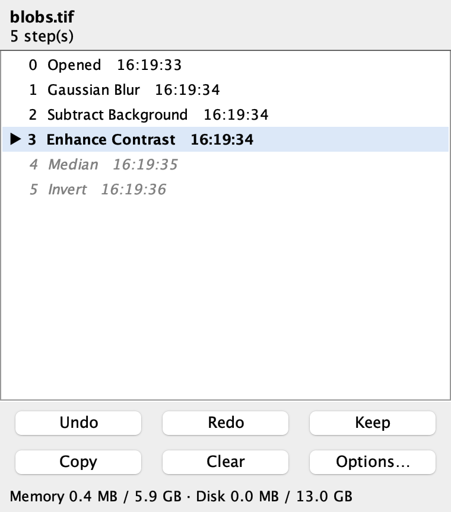

# Undo History for Fiji

**Multi-level undo and redo for Fiji / ImageJ 1.x**, with a history panel that lets you jump back to any step since the image was opened.

ImageJ 1.x, the engine underneath Fiji, keeps one undo buffer. Undo reverts only the last filter or edit, and only on the image you edited last. Edit ▸ Options ▸ Memory & Threads ▸ *Keep multiple undo buffers* only gives each image its own single buffer. It does not add more levels. Undo History keeps a full history for every open image, starting from the state the image had when you opened it.



## Install

1. Download `Undo_History-<version>.zip` from the [Releases](../../releases) page and unzip it.
2. Copy the two files into your Fiji folder (on macOS, `Fiji.app` or the folder that contains it):
   - `Undo_History.jar` → `plugins/`
   - `Undo_History_Startup.ijm` → `macros/AutoRun/` (this starts tracking every time Fiji launches)
3. Restart Fiji.

To uninstall, delete those two files.

## Use

| Action | How |
|---|---|
| Step back | **Edit ▸ Undo**, **⌘Z** on macOS, **Ctrl+Z** on Windows/Linux. Each press goes back one step |
| Step forward (redo) | **⌘⌥Z** / **Ctrl+Alt+Z**, or **Edit ▸ Redo** |
| See every step, jump to any of them | **Edit ▸ Undo History…** and click a row |
| Open a step as a new image (compare before/after) | Select the row, then **Copy** |
| Never drop a step when space runs out | Select the row, then **Keep** |
| Forget the steps of one image | **Clear** |
| Settings | **Options…**, or *Plugins ▸ Undo History ▸ Undo History Options…* |

Each of these counts as one step:

- a menu command (Gaussian Blur, Invert, 8-bit, Subtract Background, …)
- each `run("…")` call inside a macro
- each brush, pencil or flood-fill stroke (one per mouse press)
- an "Apply" from a tool window such as Brightness/Contrast

In the window, `▶` marks the current state, and grey italic rows are steps you can redo. If you undo and then make a new change, the redo steps are discarded, the same as in any editor.

After File ▸ Save, the current step is marked **[saved]**. Going back to the opened or the saved state clears the "unsaved changes" flag.

ImageJ's own undo still handles what the history does not cover, such as a selection change on an unedited image, or a paste that is still floating.

## How it stores the history: memory first, then disk

Each step stores only the planes that changed, and unchanged planes are shared between steps. A brush stroke on 1 plane of a 500-plane stack costs 1 plane. A filter applied to the whole stack costs a full copy.

- **Memory.** By default the history may use up to **33% of Fiji's maximum memory** (Edit ▸ Options ▸ Memory & Threads). In addition, **20% of Fiji's memory always stays free** for your own work, so the history never causes an out-of-memory error. Copies are stored in small chunks, which avoids a Java effect that can double the real cost of large planes (see [Tips](#tips-for-big-images)).
- **Disk.** When memory is full, older steps move to a disk folder, and they are read back when you undo to them. By default the folder is the system temp folder. You can choose the folder and the space it may use; the automatic setting is half of the free space, at most 50 GB. At least 5 GB always stays free on that disk. A fast SSD (internal or USB-C/Thunderbolt) makes a big difference.
- **When both are full,** the oldest steps of any image are dropped first. The opened state, saved states and steps you marked **Keep** are never dropped. If even that is not enough, the change is not recorded and the window says so in red.
  - In that case, Undo asks before going back, because going back would throw your latest, unrecorded changes away. You can cancel, then save a copy or give the history more room.
- **Not tracked:**
  - images larger than the memory plus disk budget
  - virtual stacks (their planes already live on disk)
  - batch-mode images that are never displayed
- **Cleanup.** Spill files are deleted when an image is closed and when Fiji quits. Folders left behind by a crash are cleaned at the next start.

The footer of the window shows how much memory and disk the history is using.

### Options

| Option | Default |
|---|---|
| Memory for history | 33% of Fiji's memory |
| When memory is full, keep older steps on disk | on |
| Disk folder | system temp folder `/FijiUndoHistory` |
| Disk space for history | automatic (half the free space, at most 50 GB) |
| Always leave free on that disk | 5 GB |
| Maximum steps per image | 100 |
| Edit ▸ Undo steps back through the history | on (off = ImageJ's single undo) |
| Redo with ⌘⌥Z / Ctrl+Alt+Z | on |
| Start a new history when an image is saved | off |
| Show the Undo History window when Fiji starts | off |

## Performance with big images

These numbers were measured on an Apple Silicon Mac with 24 GB of RAM and Fiji's memory set to 18 GB. The test images are 16-bit stacks of 2048×2040 planes. Each run records two whole-stack filters and one brush edit, then undoes everything; every restore was checked pixel for pixel.

| Image | History kept | Recording a whole-stack step | Undo / jump to a step |
|---|---|---|---|
| 1 GB | 3 steps, all in memory | 0.8 s | 0.1–0.4 s |
| 2 GB | 3 steps (6 GB memory + 71 MB disk) | 1.5–1.9 s | 0.6–0.9 s |
| 4 GB | 3 steps (6 GB memory + 6.2 GB disk) | 6.3–7.8 s | 1.5–2.1 s |
| 6 GB (history memory set to 20%) | opened state + 1 whole-stack step. The 2nd was refused (12.8 GB disk budget full) and reported | 12–15 s | 1.2–5.7 s |

A brush stroke is recorded in about 0.5 s at every size: there is a 0.3 s wait for the stroke to end, and the check itself takes about 1 ms, because on stacks over 256 MB only the touched planes are compared.

- **What runs in the background.** Recording happens on a background thread, and brush strokes and the interface stay responsive. A new menu command waits until the previous step has been recorded.
- **What limits the time.** Most of the time goes into disk writes. Writes reached 1 GB/s normally, but only 0.3 GB/s while macOS was swapping, because Fiji's memory setting plus open apps exceeded the physical RAM.
- **How big images can get.** The limit comes from memory plus disk space, not from the plugin. Each whole-stack step of a 6 GB image needs 6 GB somewhere. For images of several GB, point the disk folder to an external SSD with plenty of space.

## Tips for big images

- **2048×2048 16-bit images (common sCMOS cameras) cost twice their size in Fiji.** With large heaps, Java's G1 collector reserves a full 16 MB region for each 8 MB plane. This applies to the images themselves, not only to the history; a 1 GB stack measured 2 GB of heap. Adding the JVM option `-XX:G1HeapRegionSize=32m` brings it back to 1 GB. Undo History's own copies avoid the problem by using small chunks.
- **Don't give Fiji more memory than the machine can spare.** If Fiji's maximum plus your other apps exceed physical RAM, macOS swaps and everything slows down, history included.
- **Use Keep on important steps** so they survive when space runs short.

## What it does not track

- **Selections and display settings on their own.** Moving the B&C sliders or changing the LUT is not a step. Each step does store and restore the display range, LUTs, calibration and overlay that belong to it.
- **Commands that close an image and open a new one** (Make Composite, Stack to Hyperstack, Duplicate, …). The new image starts its own history.
- **Plugins with their own windows and undo** (SNT, TrackMate, Labkit, …). Those keep their own undo.

## Build and test

You need a Fiji installation; its bundled Java is used.

```bash
./build.sh /path/to/Fiji.app            # builds build/Undo_History.jar and installs it + the startup macro
./build.sh /path/to/Fiji.app --no-install
./test.sh  /path/to/Fiji.app            # end-to-end test in a separate ImageJ (opens a few windows briefly)
./bench.sh 1024 2048 4096               # size ladder in MB (needs RAM; HEAP=18g and PCT=20 are optional)
```

`test.sh` checks 47 behaviours:

- menu and macro commands
- brush strokes
- multi-level undo, redo and branch truncation
- stacks with plane sharing
- type conversion
- save marks
- memory limits and dropping
- the disk tier: exact restores from disk, hash detection of unchanged planes
- composite images
- the prompt before discarding unrecorded changes, and retrying an image that had no room when it opened
- no wasted re-check after an undo
- brush strokes on a 300 MB stack checking only the touched plane
- a command run the instant an image opens
- the window

Tested with ImageJ 1.54p and Java 21 (Fiji 2.18) on macOS. The jar targets Java 8. Windows and Linux are expected to work but have not been tested yet. Reports are welcome.

## License and credits

MIT License, © 2026 Ettore Colombo. See [LICENSE](LICENSE).

Developed with the help of Claude (Anthropic), from the author's design and requirements, then tested on real data.
